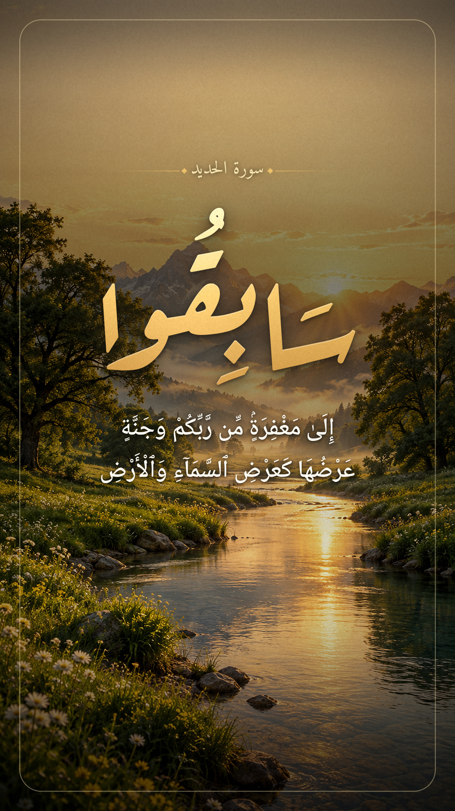

# فيديو آية — سورة الحديد ﴿٢١﴾

> سَابِقُوٓا۟ إِلَىٰ مَغْفِرَةٍۢ مِّن رَّبِّكُمْ وَجَنَّةٍ عَرْضُهَا كَعَرْضِ ٱلسَّمَآءِ وَٱلْأَرْضِ أُعِدَّتْ لِلَّذِينَ ءَامَنُوا۟ بِٱللَّهِ وَرُسُلِهِۦ ۚ ذَٰلِكَ فَضْلُ ٱللَّهِ يُؤْتِيهِ مَن يَشَآءُ ۚ وَٱللَّهُ ذُو ٱلْفَضْلِ ٱلْعَظِيمِ

**الفيديو النهائي:** [`al-hadid-21-reel.mp4`](al-hadid-21-reel.mp4) — **الغلاف (طولي 1080×1920):** [`al-hadid-21-cover.jpg`](al-hadid-21-cover.jpg)



> الغلاف: العنوان الكبير «سَابِقُوا» بخط رقعة ذهبي، وتحته بقية أول الآية، وكل الكلام جوه مساحة القص بتاعة شبكة البروفايل (3:4) عشان مايتقطعش.

| | |
|---|---|
| المقاس | 1080×1920 (ريلز إنستجرام 9:16)، 30 إطار/ث |
| المدة | ≈ 43.7 ثانية، يبدأ بالتلاوة مباشرة (اتشال 1.3 ث صمت من أول الصوت) |
| الشكل | مشهد طبيعي 16:9 بحواف دائرية في نص الشاشة، وخلفه نسخة مضببة وغامقة من نفس المشهد |
| النص | كلمة أو كلمتين في المرة، متزامنين مع التلاوة (رسم عثماني، خط Noto Naskh Arabic) |
| المشاهد | 4 مشاهد «جنة» (وادي وقت الشروق ← سهول ممتدة ← بحيرة ← أشعة فوق الجبال) متولّدة بالذكاء الاصطناعي ومتحركة بكاميرا عندها عمق (parallax) + سحب متحركة + ضباب + ذرات ضوء + تدرج لوني سينمائي |

## إعادة الإنتاج

```bash
# المتطلبات: python3, ffmpeg, numpy, opencv-python-headless, pillow (with raqm)
# الخطوط في fonts/: NotoNaskhArabic-VF.ttf و Amiri-Regular.ttf (من github.com/google/fonts)
ffmpeg -ss 1.30 -i recitation.wav -af "afade=t=in:d=0.03,afade=t=out:st=42.25:d=0.2,apad=pad_dur=1.25" -ar 48000 work/audio_trim.wav
python3 work/render.py full work/video_noaudio.mp4
ffmpeg -i work/video_noaudio.mp4 -i work/audio_trim.wav -c:v copy -c:a aac -b:a 256k -shortest al-hadid-21-reel.mp4
```

- `work/render.py` — بيرسم كل الإطارات (المشاهد، الحركة، النص، الحواف الدائرية).
- `work/timeline.json` — توقيت كل كلمة بالثانية في الصوت الأصلي (اتحسب بالتعرف على الكلام بموديل Whisper ومراجعة حدود الكلمات).
- `work/depth.py` — بيطلع خرائط العمق `scenes/d*.png` اللي بتعمل حركة الـ parallax.
- `work/cover.py` — بيعمل الغلاف من `scenes/cover_bg.png` (محتاج كمان خط `ArefRuqaa-Bold.ttf`).
- `scenes/` — صور المشاهد الأربعة وخرائط العمق بتاعتها، وخلفية الغلاف.

---

# فيديو آية — سورة المائدة ﴿٢٣﴾

> قَالَ رَجُلَانِ مِنَ ٱلَّذِينَ يَخَافُونَ أَنْعَمَ ٱللَّهُ عَلَيْهِمَا ٱدْخُلُوا۟ عَلَيْهِمُ ٱلْبَابَ فَإِذَا دَخَلْتُمُوهُ فَإِنَّكُمْ غَٰلِبُونَ ۚ وَعَلَى ٱللَّهِ فَتَوَكَّلُوٓا۟ إِن كُنتُم مُّؤْمِنِينَ

**الفيديو:** [`al-maidah-23-reel.mp4`](al-maidah-23-reel.mp4) — 1080×1920، ≈ 42.6 ثانية، نفس ستايل فيديو الحديد (المشهد في مستطيل بحواف دائرية في النص).

- الفيديو الأصلي (مطر بالليل وبيت خشب) متركب عليه التلاوة، ومشال من أول الصوت ثانية صمت عشان يبدأ بالقراءة على طول.
- صوت المطر الأصلي متساب واطي جدًا تحت التلاوة.
- الآيات كلمة أو كلمتين متزامنة مع القارئ، والمقاطع اللي القارئ كررها («ٱدْخُلُوا۟ عَلَيْهِمُ» و«وَعَلَى ٱللَّهِ فَتَوَكَّلُوٓا۟») ظاهرة مرتين زي ما اتقرت.

```bash
python3 work/render2.py source.mp4 video2_noaudio.mp4   # بيقرا work/timeline2.json
```
